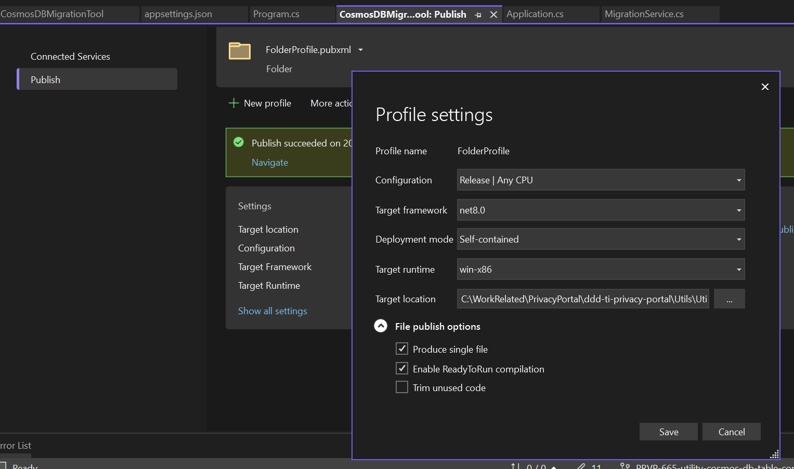

# Cosmos DB Migration Tool

This console application is designed to migrate data between two Cosmos DB instances. The application requires a valid configuration for both the **Source Cosmos DB** and **Destination Cosmos DB** to perform the migration.

## How to Distribute the Application to the Client

### 1. **Distribute the Application Package**

When providing the application to the client, you will need to give them the following files:

-   **Single Executable File**: This file contains the application and all required dependencies (DLLs, .NET runtime, etc.). It will have the extension `.exe` for Windows (e.g., `CosmosDBMigrationTool.exe`).
-   **`appsettings.json` File**: This configuration file is used to define the connection details for the **Source Cosmos DB** and **Destination Cosmos DB**. The client must update this file with their own configuration.

Ensure that the **`appsettings.json`** file is placed **next to** the compiled executable file.

#### Build Single Executable

-   Use the publish settings shown in .
-   Make sure that `Trim unused code` option is unchecked - [Ref](https://github.com/dotnet/runtime/issues/49062)
-   After publishing, distribute only the `CosmosDBMigrationTool.exe` and `appsettings.json` files.

### 2. **Ensure the Client Can Edit `appsettings.json`**

The client must be able to edit the `appsettings.json` file to configure their own Cosmos DB connections.

## Step-by-Step Guide for Clients

Here are the steps that the client must follow to configure the application to work with their Cosmos DB instances:

### Client Instructions: Configuring the Application

1. **Obtain the Required Information**:

    - The client should obtain the following credentials for both the **Source Cosmos DB** and **Destination Cosmos DB**:
        - **Endpoint**: The URL of the Cosmos DB account (e.g., `https://<account-name>.documents.azure.com:443/`).
        - **Key**: The primary or secondary key for the Cosmos DB.
        - **DatabaseName**: The name of the Cosmos DB database the client wants to use for the migration.
        - **ContainerName**: The name of the container (collection) within the database.

2. **Edit the `appsettings.json` File**:
   The client will find the `appsettings.json` file in the folder where the application is located. This file contains the configuration for both the source and destination Cosmos DB connections. The client should open the `appsettings.json` file using any text editor (e.g., Notepad, VS Code) and replace the placeholders with their actual values.

    Here is the structure of `appsettings.json`:

    ```json
    {
        "CosmosConfig": {
            "SourceCosmos": {
                "Endpoint": "",
                "Key": "",
                "DatabaseName": "",
                "ContainerName": ""
            },
            "DestinationCosmos": {
                "Endpoint": "",
                "Key": "",
                "DatabaseName": "",
                "ContainerName": ""
            }
        }
    }
    ```

    The client should replace the placeholders with their actual values:

    ```json
    {
        "CosmosConfig": {
            "SourceCosmos": {
                "Endpoint": "https://source-cosmos-db.documents.azure.com:443/",
                "Key": "source-key-here",
                "DatabaseName": "source-database-name",
                "ContainerName": "source-container-name"
            },
            "DestinationCosmos": {
                "Endpoint": "https://destination-cosmos-db.documents.azure.com:443/",
                "Key": "destination-key-here",
                "DatabaseName": "destination-database-name",
                "ContainerName": "destination-container-name"
            }
        }
    }
    ```

### Save the `appsettings.json` File

After the client has filled in the values, they should save the changes to the `appsettings.json` file.

### Run the Application

The client can then run the application by double-clicking on the executable. The application will automatically read the values from the `appsettings.json` file and use them to connect to the specified Cosmos DB instances for migration.

## Notes for Developers

-   **Security**: Make sure not to include sensitive information like Cosmos DB keys in source control. When sharing the application, always provide the configuration file with placeholders and instruct the client to fill in their own credentials.
-   **Environment-Specific Configuration**: If you need to use different configurations for the development environment, you can utilize `appsettings.Development.json`.
